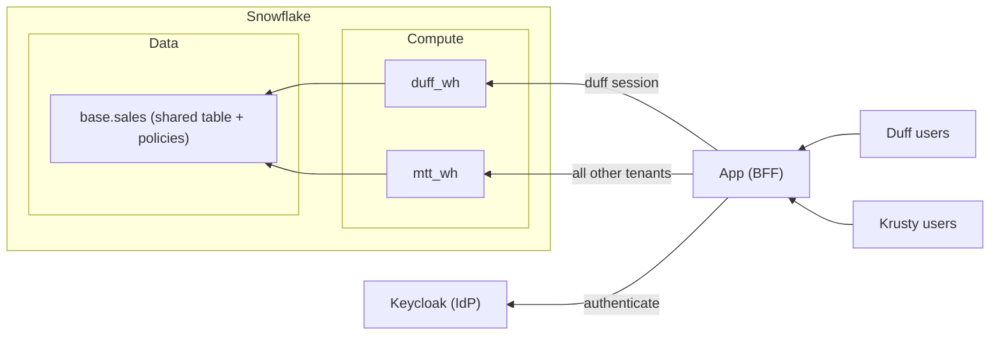

# Variation: Noisy Neighbor

## Situation

In the basic MTT architecture, all tenants share all data and compute. If one tenant runs many more queries, or many
more at once, than its neighbors, everyone else can see queueing and slowdowns. This is the noisy neighbor problem.

With Snowflake, you can give the noisy tenant its own warehouse and route its queries there instead of the shared
`mtt_wh`. Because everything runs as one service user and one role, the routing decision comes from **data**: a
tenant → warehouse table next to the entitlements. Adding a dedicated tenant is still DML, apart from creating the
warehouse itself.



The data is still shared by every tenant. Duff's load lands on compute that only Duff uses, which you can bill at a
premium.

## How to achieve this

### 1. Provision the warehouse and the routing table

Add `data/migrations/006_noisy_neighbor.sql`:

```sql
USE ROLE ACCOUNTADMIN;

CREATE WAREHOUSE IF NOT EXISTS duff_wh
  WAREHOUSE_SIZE = 'XSMALL' AUTO_SUSPEND = 60 AUTO_RESUME = TRUE INITIALLY_SUSPENDED = TRUE;
GRANT USAGE ON WAREHOUSE duff_wh TO ROLE mtt_admin;
-- One app role: it needs USAGE on every warehouse it may be routed to.
GRANT USAGE ON WAREHOUSE duff_wh TO ROLE mtt_app_role;

USE ROLE mtt_admin;
USE WAREHOUSE mtt_wh;

-- Tenants without a row use the shared mtt_wh.
CREATE TABLE IF NOT EXISTS mtt_db.security.tenant_compute (tenant_id STRING, warehouse STRING);
MERGE INTO mtt_db.security.tenant_compute t USING (SELECT 'duff' tenant_id, 'DUFF_WH' warehouse) s
  ON t.tenant_id = s.tenant_id
  WHEN MATCHED THEN UPDATE SET warehouse = s.warehouse
  WHEN NOT MATCHED THEN INSERT VALUES (s.tenant_id, s.warehouse);

-- The app role still has nothing on `security`; this secure view resolves only
-- the current session's end user, with the same binding the policies use.
CREATE OR REPLACE SECURE VIEW mtt_db.serving.my_compute AS
  SELECT e.tenant_id, COALESCE(c.warehouse, 'MTT_WH') AS warehouse
  FROM mtt_db.security.entitlements e
  LEFT JOIN mtt_db.security.tenant_compute c USING (tenant_id)
  WHERE e.end_user_id = SYS_CONTEXT('SNOWFLAKE$SESSION_ATTRIBUTES', 'end_user_id')
    AND e.app_user    = CURRENT_USER();
GRANT SELECT ON VIEW mtt_db.serving.my_compute TO ROLE mtt_app_role;
```

Moving another tenant onto dedicated compute is then one `INSERT` into `security.tenant_compute`, once the warehouse
exists and the app role has `USAGE` on it.

### 2. Route dashboard queries in the BFF

In `api/src/snowflake.ts`, look up the user's warehouse once and cache it briefly. Then pass it on each statement in
place of the fixed `WAREHOUSE`:

```diff
+const compute = new Map<string, { wh: string; at: number }>();
+const warehouseFor = async (endUserId: string) => {
+  const hit = compute.get(endUserId);
+  if (hit && Date.now() - hit.at < 60_000) return hit.wh;
+  const [row] = await run<{ WAREHOUSE: string }>(endUserId, WAREHOUSE,
+    `SELECT warehouse AS "WAREHOUSE" FROM mtt_db.serving.my_compute`);
+  const wh = row?.WAREHOUSE ?? WAREHOUSE;
+  compute.set(endUserId, { wh, at: Date.now() });
+  return wh;
+};
```

Here `run` is the existing body of `queryAs`, with the warehouse as a parameter. `queryAs` becomes
`run(id, await warehouseFor(id), statement)`. The lookup runs under the same session attribute, so a user can only ever
resolve their own tenant's warehouse.

### 3. The agent

The agent's SQL runs on the warehouse named in its specification (`execution_environment.warehouse` in
`005_agent.sql`). I haven't verified whether `agent:run` lets you override the warehouse per request. Until you've
confirmed that against the current Cortex Agents REST reference, isolate agent compute at the agent level:

- Create `serving.sales_agent_duff` with the same spec but `warehouse: DUFF_WH`.
- Have the BFF choose the agent name from the same `my_compute` lookup.

### Verify

Log in as each user and check the warehouse. Add `CURRENT_WAREHOUSE() AS "WAREHOUSE"` to the dashboard's identity
query and show it on the identity card.

- **Barney** / **Moe** (Duff): `DUFF_WH`.
- **Marge** / **Homer** (Krusty): `MTT_WH`.

### Clean up

Add the following to `data/teardown/teardown.sql` (dropping the database removes the table and view):

```diff
 DROP WAREHOUSE IF EXISTS mtt_wh;
+DROP WAREHOUSE IF EXISTS duff_wh;
```
