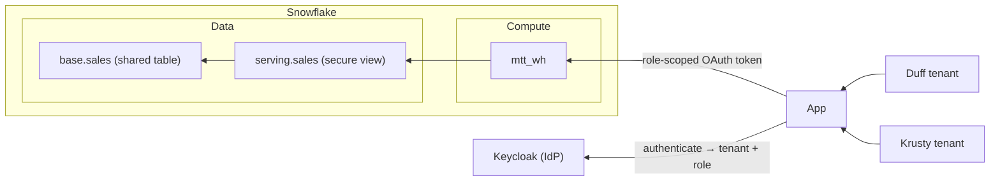

# Variation: Per-Tenant Roles

## Situation

Earlier, this example gave each tenant its own Snowflake identity:

- one `TYPE = SERVICE` user per tenant (`TENANT_DUFF_SVC`, `TENANT_KRUSTY_SVC`)
- one role per tenant and access level (`TENANT_DUFF_ADMIN`, `TENANT_DUFF_VIEWER`, …)

Keycloak issued tokens that Snowflake trusted over **External OAuth**. Each token's `snowflake_user` claim selected the
service user and its `scp` claim selected the role. A secure view joined `CURRENT_ROLE()` to an entitlements table for
row isolation, and masking keyed off the `_ADMIN` role suffix.



That design is preserved, fully runnable, in [`mtt/variations/per_tenant_roles/`](../variations/per_tenant_roles),
along with its own walkthrough and its earlier noisy-neighbor and single-service-user notes.

## Why the main example moved away from it

Both designs keep the data in one shared table. They differ in how much work a new tenant takes.

| Adding a tenant            | Per-tenant roles (this variation)                                      | Session attributes (main example)  |
| -------------------------- | ---------------------------------------------------------------------- | ---------------------------------- |
| Snowflake objects          | A role per access level, a service user, grants on db/schema/view/warehouse | None                          |
| Entitlements               | A row per role                                                         | A row per end user                 |
| IdP                        | A machine client per tenant and level, plus claim mappers              | Just the user login                |
| Snowflake ↔ IdP plumbing   | External OAuth integration, public JWKS (ngrok)                        | None (key-pair service user)       |
| Who can create a tenant    | Someone holding `CREATE ROLE`/`CREATE USER` (DDL)                      | Anyone with `INSERT` on entitlements (DML) |

Roles and users grow with the number of tenants (and access levels), every onboarding is a DDL change that someone has
to review, and the number of grants grows with them. Snowflake can hold many roles; the cost is mostly operational
overhead and change risk, not a hard limit.

## Where per-tenant roles still win

- **Snowflake authenticates the tenant.** The signed OAuth token chooses the role, and Snowflake verifies it. With
  session attributes, Snowflake trusts whatever end user the BFF names, so a compromised BFF or a leaked service-user key
  can reach every tenant bound to that user. With per-tenant identities, a compromised credential exposes only one tenant.
- **Native attribution and revocation.** `CURRENT_USER()` and `CURRENT_ROLE()` identify the tenant in query history.
  You can disable one tenant's user or revoke one role without touching anyone else.
- **Per-tenant grants.** Warehouses, objects or features can be granted to a single tenant's role, for example for the
  noisy-neighbor pattern.

**When to choose it:** tenants are few, high-value, or need Snowflake itself to hold the tenant boundary, for example
for regulatory or contractual isolation. For many tenants, or end users without Snowflake identities, use the session
attribute design in the [main walkthrough](./00_WALKTHROUGH.md). To narrow the blast radius of the shared service user,
use one per application or per high-value tenant.

## A single service user with per-tenant roles

A middle option:

- Keep the per-tenant roles, but grant them all to one service user, `MTT_APP_SVC`.
- Map every token to that user.
- Set `EXTERNAL_OAUTH_ANY_ROLE_MODE = DISABLE` on the integration, so each token can activate only the single
  `session:role:` scope it was issued.
- Keep secondary roles off.

This removes the per-tenant users, but you still create roles for every tenant, so onboarding is still DDL. It also
loses the per-tenant `CURRENT_USER()` and independent user disablement. The full steps are in
[`variations/per_tenant_roles/docs/02_variation_single_service_user.md`](../variations/per_tenant_roles/docs/02_variation_single_service_user.md).

## Running it

The variation is a self-contained copy of the earlier example, with its own `compose.yaml`, `justfile` and migrations.
It creates the same `mtt_db`, `mtt_wh` and `mtt_admin` names as the main example, so **tear one down before running the
other** in the same account:

```sh
cd mtt/variations/per_tenant_roles
cp .env.example .env   # NGROK_AUTHTOKEN, KEYCLOAK_PUBLIC_URL, SNOWFLAKE_HOST
```

Then follow [its walkthrough](../variations/per_tenant_roles/docs/00_WALKTHROUGH.md):

1. `just setup <conn>`
2. `just idp-up`
3. `just idp-seed`
4. `just oauth-add <conn>`
5. `just idp-add-users`
6. `just app-up`

It needs a free ngrok static domain so Snowflake can fetch Keycloak's signing keys.
